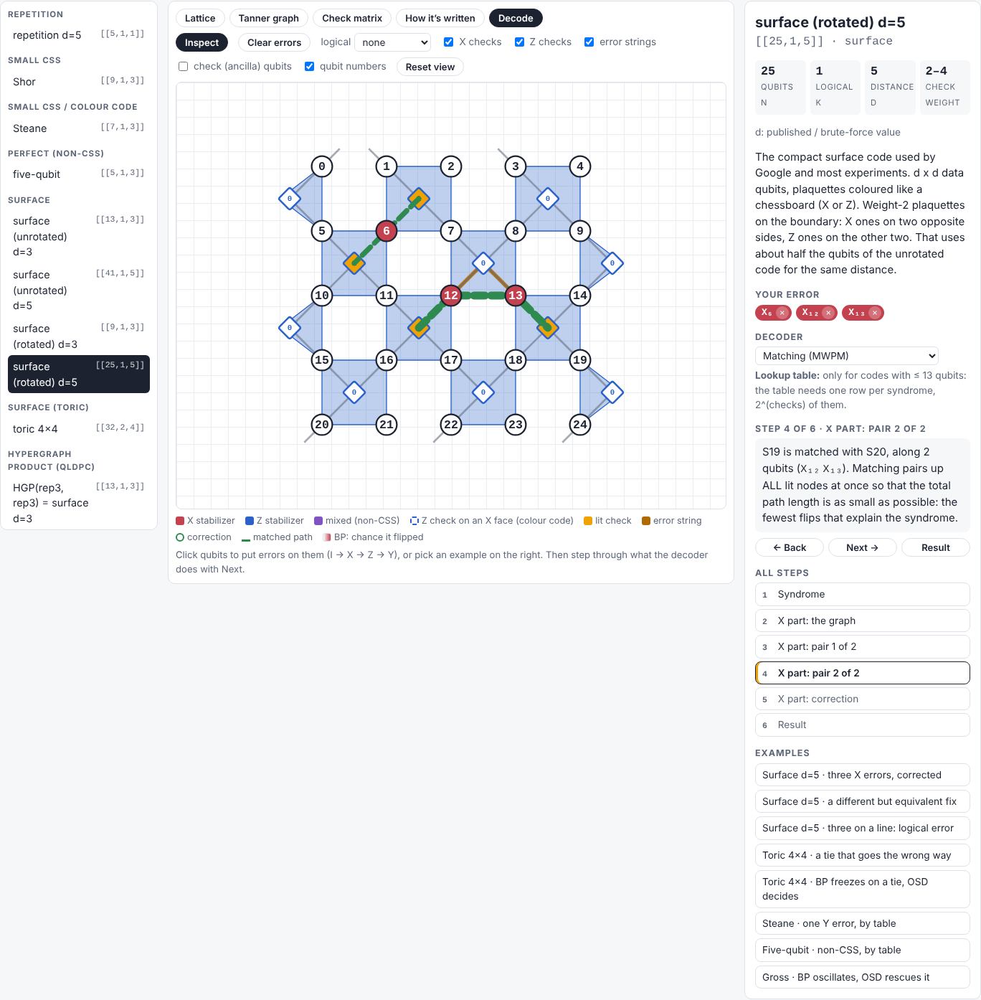
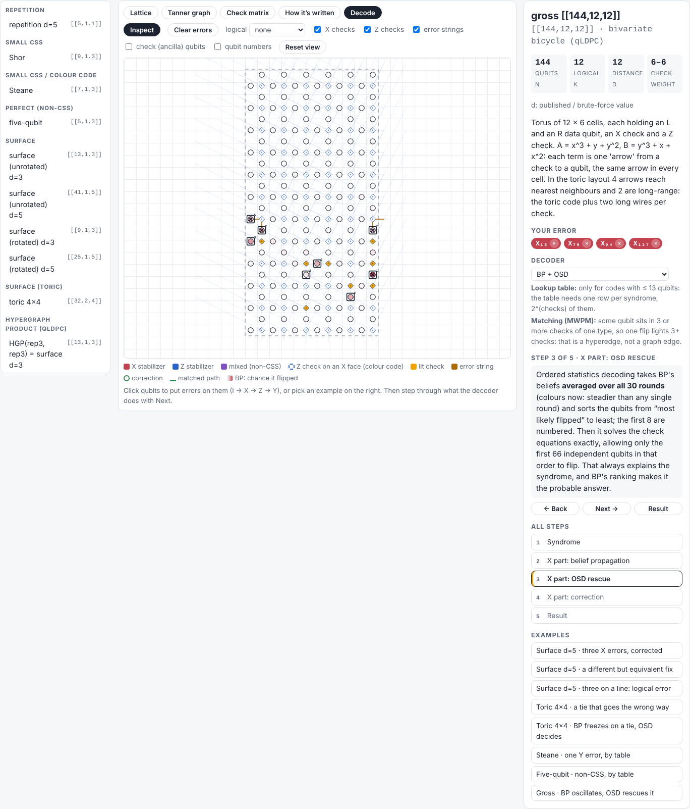

# qdec: quantum codes and decoders from scratch, so you can *see* them work

> Any quantum error-correcting code can be written down as a check matrix and drawn as a picture.
> Start from that, build the decoders yourself, and watch every step they take.

`qdec` is a small, readable Python package plus a browser explorer. It builds 16 quantum codes from their geometry and their
check matrices, writes the noisy circuits for them, decodes with **our own** decoders, and draws every step on the way. It is meant as a
**tutorial and a review in code form**: theory first, with code you can read line by line, and pictures for everything.

<p align="center">
  
  
</p>

**Try it without installing anything:** open [`explorer/index.html`](explorer/index.html) in a browser (one self-contained file), or the
**live copy on the documentation site** (see [Documentation](#documentation)).

---

## The idea

1. **A code is a check matrix plus a picture.** Every code (repetition, Shor, Steane, the five-qubit code, surface codes, toric, hypergraph
   products, the bivariate-bicycle family including IBM's gross code) becomes the *same* Python object: its stabilizers in symplectic form
   `(Sx | Sz)`, and a geometry saying where each qubit and each check is drawn. From that alone we compute n, k, d, the logical operators
   and the syndrome of any error.
2. **Look at it four ways.** As a lattice, a Tanner graph, a check matrix, and in its written forms (stabilizer list, 0/1 matrices,
   polynomials such as the gross code's A = x³ + y + y², B = y³ + x + x²).
3. **Make it noisy.** We write the syndrome-extraction circuits ourselves (including a CNOT order that avoids hook errors). Stim only
   *runs* them and gives the detector error model, which tells you whether matching can work (a graph) or not (a hypergraph).
4. **Decode it with decoders written here**: lookup table, minimum-weight perfect matching (MWPM), belief propagation (BP) and BP + OSD.
   PyMatching and `ldpc` are used **only as referees** in the tests, and ours agree with them.
5. **See every step.** BP's beliefs round by round, matching's pairs one at a time, OSD's ranking, and whether the result was exact, a
   harmless *degeneracy*, or a *logical error*.

## What you can do with it

| you want to… | where |
|---|---|
| click around a code: put errors on qubits, see which checks light up, see logicals drawn as strings | **explorer** (`explorer/index.html`), Lattice tab |
| see the same code as a Tanner graph, a check matrix (with your syndrome as the last column), or written as polynomials | explorer: Tanner graph / Check matrix / How it's written tabs |
| watch a decoder correct *your* error step by step and learn whether it succeeded, failed, or found an equivalent fix | explorer: **Decode** tab (lookup, MWPM, BP + OSD; 8 ready-made examples) |
| read the story from codes to decoding, with a figure at every step | `notebooks/01` … `07` |
| build your own code from check matrices and draw it | `qdec.core.StabilizerCode.css(...)`; see the [user guide](docs/USER_GUIDE.md) |
| run a threshold sweep with *our* decoders through Sinter | `qdec.decoders.sinter_decoders()` |
| know how far each claim was checked | `tests/` (239 tests) and [`docs/TESTS.md`](docs/TESTS.md) |

## The 16 codes

| family | codes (n, k, d computed) |
|---|---|
| small codes | repetition [[5,1,1]] (d = 5 against bit flips) · Shor [[9,1,3]] · Steane [[7,1,3]] · five-qubit [[5,1,3]] (non-CSS) |
| surface codes | unrotated [[13,1,3]], [[41,1,5]] · rotated [[9,1,3]], [[25,1,5]] · toric [[32,2,4]] |
| hypergraph products | HGP(rep, rep) [[13,1,3]] (= the unrotated surface code) · HGP(Hamming, Hamming) [[58,16,3]] |
| bivariate bicycle (qLDPC) | [[72,12,6]] · [[90,8,10]] · [[108,8,10]] · **gross [[144,12,12]]** · [[288,12,18]] |

Distances come from brute force for small codes and from Stim's searches otherwise: exact for codes whose errors light at most two checks
(surface codes, at any size), an upper bound that matches the published value for the qLDPC codes.

## Results you can reproduce

* **Our MWPM = PyMatching** on every tested shot (rotated surface code, d = 3, 5, 7, circuit noise).
* **Our BP = ldpc's BP**: same corrections, iteration counts and beliefs. **Our BP + OSD ≥ ldpc's** on the gross code, because OSD ranks
  qubits by BP's belief *averaged over iterations*, which is steadier when BP oscillates.
* **Hook errors, measured:** the rotated surface code keeps circuit distance 3, 5, 7 with the Z/N CNOT order; a plain order drops the
  X basis to 2, 3, 4.
* **Graph vs hypergraph:** surface-code faults split into ≤ 2-detector pieces (matching works); gross-code faults light up to 9 detectors
  (it needs BP + OSD).
* **Stim distance trap:** `shortest_graphlike_error` reports d = 1 for HGP(Hamming); we only use it where it is exact.
* **The browser decoders are the Python decoders:** identical answers on 1050/1050 random errors.

## Quick start

```bash
git clone https://github.com/<your-username>/<this-repo>.git
cd <this-repo>
conda env create -f environment.yml          # Python 3.12 + numpy, scipy, matplotlib, stim, sinter, ...
conda activate qec-decoders
python -m pytest -q tests/                   # 239 passed, 2 skipped, about a minute
jupyter lab notebooks/                       # start with 01
```

```python
from qdec.families import surface_rotated, bb
from qdec.views import code_card

code = surface_rotated(5)
print(code.summary())        # surface (rotated) d=5  [[25,1,5]] ...
code_card(code)              # lattice + Tanner graph + check matrix + logicals in one figure
print(bb("gross").n, bb("gross").k)          # 144 12
```

Step-by-step setup (Windows included), the optional Node.js / Playwright test dependencies, rebuilding the explorer and building the docs:
**[docs/GETTING_STARTED.md](docs/GETTING_STARTED.md)**.

## What is in the folder

```
qdec/            the package: codes, geometry, pictures, circuits, detector graphs, decoders
explorer/        Stabilizer Atlas, the browser explorer (template.html + decoders.js -> index.html)
notebooks/       01 BP on the torus · 02 code atlas · 03 Jupyter widgets · 04 circuits & detector graphs ·
                 05 decoding pictures · 06 distance, logicals, written forms · 07 live decoding
tests/           239 tests (pytest)
docs/            user guide, code-reading guide, architecture, developer reference, tests, code catalogue, figures
mkdocs.yml       the documentation website (MkDocs Material)
```

## Documentation

The `docs/` folder is also a website built with [MkDocs Material](https://squidfunk.github.io/mkdocs-material/). It includes the
notebooks (with their figures), the API reference generated from the docstrings, and a **live copy of the explorer**.
Build it with `mkdocs serve` (see [Getting started](docs/GETTING_STARTED.md#7-the-documentation-website)); on GitHub it is published to
GitHub Pages by `.github/workflows/docs.yml`.

| read this | if you want to |
|---|---|
| [Getting started](docs/GETTING_STARTED.md) | install, run the tests, notebooks and explorer, build the website |
| [User guide](docs/USER_GUIDE.md) | use the explorer and the package |
| [Reading the code](docs/CODE_GUIDE.md) | understand the code: reading order, how data flows, one decode traced through the files |
| [Architecture](docs/ARCHITECTURE.md) | the design decisions and why, verified results, limits, roadmap |
| [Developer reference](docs/DEVELOPER_REFERENCE.md) | every module, class and function in tables |
| [Tests](docs/TESTS.md) | what each test proves |
| [Code catalogue](docs/CODE_CATALOGUE.md) | the theory behind each code family, with references |

## Status and roadmap

Done: 16 codes, four views, memory circuits, detector graphs, lookup / MWPM / BP / BP + OSD, the explorer with live step-by-step decoding.
Next: the Stim circuit beside the lattice in the explorer; Union-Find decoding with cluster-growth pictures; our own blossom algorithm;
then clustering decoders (BP-LSD, ambiguity clustering) and Relay-BP. Full list in [Architecture § Roadmap](docs/ARCHITECTURE.md#7-roadmap-next-units).

## References

Bravyi et al., *High-threshold and low-overhead fault-tolerant quantum memory*, Nature 627, 778 (2024), arXiv:2308.07915 ·
Kitaev, Ann. Phys. 303, 2 (2003) · Dennis, Kitaev, Landahl & Preskill, J. Math. Phys. 43, 4452 (2002) · Gottesman, PhD thesis,
arXiv:quant-ph/9705052 · Tillich & Zémor, arXiv:0903.0566 · Edmonds, Can. J. Math. 17, 449 (1965) · Higgott & Gidney, arXiv:2303.15933
(PyMatching) · Gidney, *Quantum* 5, 497 (2021) (Stim) · Panteleev & Kalachev, *Quantum* 5, 585 (2021) · Roffe et al., arXiv:2005.07016
(BP + OSD) · Poulin & Chung, QIC 8, 987 (2008) · Tomita & Svore, PRA 90, 062320 (2014). Full lists in [the code catalogue](docs/CODE_CATALOGUE.md).
