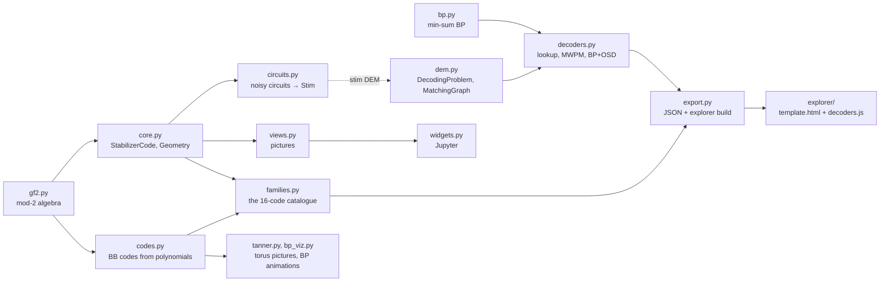

# Reading the code

This page is a map for reading the source. For each file it says what the file is *for*, which parts to read first, and how the files
hand data to each other. It ends with three journeys traced through the code and recipes for extending it. The full function tables
are in the [developer reference](DEVELOPER_REFERENCE.md) and the generated [API reference](api/index.md).

The package is about 3,500 lines of Python plus 1,150 lines of JavaScript for the explorer. Every file opens with a docstring headed
**"What this file is FOR"**. Read that first, then the code.

## 1. The one idea the code is built on

Every code becomes the same object, `StabilizerCode` (`qdec/core.py`):

```
StabilizerCode
  Sx, Sz      (m, n) 0/1 arrays: generator i = product over qubits q of X^Sx[i,q] · Z^Sz[i,q]   (both 1 → Y)
  geometry    where each qubit and each check is drawn (and whether the picture wraps, as on a torus)
  info        family, plain-language description, references, published distance, CNOT order ...
```

This is the **symplectic form**: a Pauli on $n$ qubits is a pair of bit vectors $(x \mid z)$, and two Paulis commute exactly when

$$
x_1 \cdot z_2 + z_1 \cdot x_2 = 0 \pmod 2
$$

([Gottesman's thesis](https://arxiv.org/abs/quant-ph/9705052), ch. 3). That one formula covers CSS and non-CSS codes alike, so
pictures, circuits, syndromes and decoders are each written once and work for all 16 codes.

## 2. How the files depend on each other



Rules that keep it readable:

* **Arrows only point one way.** `core` never imports `families`; `decoders` never imports `views`. Pictures sit on top of logic, never inside it.
* **Stim is used in exactly two files.** `circuits.py` builds `stim.Circuit`s; `dem.py` reads Stim's detector error model (DEM) into our own
  objects. Decoders never see a Stim object.
* **Reference tools only referee.** PyMatching and `ldpc` appear only in `tests/` and in comparison cells of the notebooks.

## 3. Reading order

Read in this order, and stop wherever you have what you need.

| # | file | lines | what it is FOR | read first |
|---|---|---|---|---|
| 1 | `qdec/gf2.py` | 106 | linear algebra over bits (XOR instead of +): row reduction, rank, null space, solving H·e = s | `row_reduce` (used by everything else) |
| 2 | `qdec/core.py` | 330 | the common code object | `Geometry`, `StabilizerCode.css`, `syndrome`, `logicals` (symplectic Gram–Schmidt), `distance` (brute force) |
| 3 | `qdec/families.py` | 361 | builds the catalogue: each code's check matrices *and* its drawing positions | `steane` (smallest real code), `surface_rotated` (note `info['cnot_order']`), `hypergraph_product`, `catalogue` |
| 4 | `qdec/codes.py` | 294 | bivariate-bicycle codes from two polynomials: shift matrices `x`, `y`; H_X = [A\|B], H_Z = [Bᵀ\|Aᵀ]; Bravyi's toric layout | `shift_matrices`, `poly_matrix`, `BBCode` |
| 5 | `qdec/views.py` | 391 | matplotlib pictures of any code | `draw_lattice`, then `code_card` |
| 6 | `qdec/circuits.py` | 297 | writes the noisy syndrome-extraction circuit for any CSS code | `cnot_layers` (gate order, hook errors), `memory_circuit`, `stim_distance` |
| 7 | `qdec/dem.py` | 232 | turns Stim's DEM into decoder input: a check matrix (any decoder) or a graph (matching) | `parse_dem`, `DecodingProblem`, `MatchingGraph` |
| 8 | `qdec/bp.py` | 163 | min-sum belief propagation that records every iteration | `MinSumBP.decode` |
| 9 | `qdec/decoders.py` | 410 | our decoders behind one `decode(syndrome)` call, plus Sinter adapters | `LookupDecoder`, `MWPMDecoder.decode`, `BPOSDDecoder._osd` |
| 10 | `qdec/export.py` | 429 | everything the browser explorer needs, as JSON, and the build of `index.html` | `code_to_dict`, `reduce_logical`, `written_forms`, `build_explorer_html` |
| 11 | `explorer/decoders.js` | 295 | the same decoders in JavaScript, so the page can decode your clicks | `mwpm`, `bp`, `bposd`, `verdict` |
| 12 | `explorer/template.html` | 855 | the explorer page: SVG drawing, tabs, inspector, the Decode tab's steps | `drawBoard`, `buildRun` |
| — | `qdec/tanner.py`, `qdec/bp_viz.py` | 339 | Tanner graphs on the torus and BP animations (part 1 of the series, BB codes only) | when you read notebook 01 |
| — | `qdec/widgets.py` | 166 | the explorer inside Jupyter (ipywidgets) | when you read notebook 03 |

## 4. Conventions used everywhere

| convention | meaning |
|---|---|
| 0/1 arrays are `np.uint8` | `gf2.as_gf2` converts anything; arithmetic is `% 2` or `^` |
| a Pauli on n qubits | a length-2n row `(x \| z)`; Y = both bits set |
| `H_X`, `H_Z` | rows = X-type / Z-type generators. **Z checks see X errors** and vice versa: syndrome of X errors `e` is `H_Z @ e % 2` |
| generator index vs row index | `code.index_of('Z')[r]` is the generator that is row `r` of `H_Z`. The explorer always uses generator indices |
| geometry | (x, y) with **y growing downward** (like the screen); `period` set → the picture wraps (torus) |
| `info` keys | `family`, `description`, `references`, `d_known`, optional `dX`, `dZ`, `cnot_order`, `A`, `B`, `l`, `m` |
| decoder output | observable flips; `MWPMDecoder.decode` returns them as an **int bitmask** (bit k = observable k), the others as a 0/1 array |
| comments | each file's docstring explains the *why*; inline comments explain non-obvious lines; references are given where an idea comes from a paper |

## 5. Three journeys through the code

### Journey A: from two polynomials to the gross code you can draw

```python
from qdec.families import bb
gross = bb("gross")
```

1. `families.bb("gross")` looks up `BB_TABLE["gross"] = (l=12, m=6, A terms, B terms, d=12)`.
2. `codes.BBCode(l, m, A, B)` builds the shift matrices `x = S_l ⊗ I_m`, `y = I_l ⊗ S_m` (`codes.shift_matrices`), sums the monomials
   into 72 × 72 matrices `A`, `B` (`codes.poly_matrix`) and stacks `H_X = [A | B]`, `H_Z = [Bᵀ | Aᵀ]`.
3. It also decides where to draw everything. Each of the l·m cells of the torus holds one L qubit, one R qubit, one X check and one Z
   check (`BBCode.layout`). Following Bravyi et al.'s *toric layout*, two terms of A and two terms of B are used as the "down" and "right"
   grid steps, so every check gets four nearest-neighbour edges (a toric code) and the remaining terms become the visible long-range edges.
4. `families._from_bb` wraps that into a `StabilizerCode.css(...)` with a `Geometry(period=...)` and the `info` text.
5. Now `gross.k` (12) comes from `core`: n − rank(H_X) − rank(H_Z) using `gf2.rank`; `gross.logicals()` from Gram–Schmidt;
   `views.draw_lattice(gross)` from the geometry.

### Journey B: one noisy experiment, decoded by our matching

```python
from qdec.families import surface_rotated
from qdec.circuits import memory_circuit
from qdec.dem import MatchingGraph
from qdec.decoders import MWPMDecoder

code = surface_rotated(5)
circuit = memory_circuit(code, rounds=5, p=0.003, basis="Z")
dem = circuit.detector_error_model(decompose_errors=True, approximate_disjoint_errors=True)
decoder = MWPMDecoder(MatchingGraph(dem))
det, obs = circuit.compile_detector_sampler().sample(1000, separate_observables=True)
failures = sum((decoder.decode(s) & 1) != o[0] for s, o in zip(det, obs))
```

| step | where | what happens |
|---|---|---|
| gate order | `circuits.cnot_layers(code, "Z")` | each layer = CNOTs that touch every qubit at most once. The rotated surface code uses the **Z/N order** from `info['cnot_order']`, so that a fault on an ancilla mid-round spreads to two qubits *across* the logical, not along it (no hook errors) |
| circuit | `circuits.memory_circuit` | data qubits 0…n−1, then X-check ancillas, then Z-check ancillas, placed at `check_pos`. Each round: X checks, then Z checks; noise after every gate; detectors compare each ancilla with its previous round; at the end the data are read out and the Z logical becomes the observable |
| DEM | Stim | lists every fault as "flips these detectors and these observables, with probability p" |
| graph | `dem.MatchingGraph` | detectors become nodes plus one boundary node; each fault that flips ≤ 2 detectors becomes an edge with weight log((1−p)/p); parallel faults are merged; faults Stim could not split are counted in `.dropped` |
| decode | `decoders.MWPMDecoder.decode` | Dijkstra from every lit detector (`_dijkstra`) → exact pairing by dynamic programming over subsets (≤ 20 lit) or scipy MILP (`_exact_ilp`) → XOR of the observable masks along the chosen paths |
| check | `tests/test_decoders.py` | the same shots through PyMatching: identical predictions |

For a qLDPC code, swap the last two rows: `dem.DecodingProblem.from_dem(dem)` gives a check matrix with per-fault priors, and
`decoders.BPOSDDecoder(problem)` runs `bp.MinSumBP`, then OSD ranked by BP's belief averaged over iterations.

### Journey C: you click a qubit in the explorer and press Next

1. **Build time.** `export.build_explorer_html` calls `build_atlas_data`, which runs `code_to_dict` on all 16 codes (generators,
   positions, reduced logicals, lookup tables for n ≤ 13, the three written forms, distance via `distance_info`). It pastes that JSON and
   `explorer/decoders.js` into `template.html` → `index.html`.
2. **Click.** `clickQubit(q)` in `template.html` cycles `state.err[q]` I → X → Z → Y and calls `render()`.
3. **Decode tab.** `ensureDecode()` sees the error changed and calls `buildRun()`. That picks a decoder (`chosenDecoder`), splits a Y into
   its X and Z parts (`QDec.splitError`), and calls `QDec.mwpm` / `QDec.bposd` / `QDec.lookup` from `decoders.js`.
4. **Steps.** `buildRun` turns the run into a list `{title, text, ov}`. `ov` (overlay) says what to draw: `graph`, `pairs`, `bp`, `ranked`,
   `corr`, `residual`. `drawBoard()` reads the current step's `ov`.
5. **Verdict.** Residual = error × correction (`mul`); `syndrome()` checks it lights nothing; `QDec.verdict` checks it against every
   logical: nothing left → *exact*; a stabilizer → *degeneracy*; a logical → *logical error*.
6. **Trust.** `tests/test_explorer_decoders.py` runs `decoders.js` in Node and requires identical answers to `MWPMDecoder`, `MinSumBP` and
   `BPOSDDecoder`, then clicks every example in a headless browser.

## 6. Recipes: extending the code

**Add a code family**

1. Write a function in `families.py` that returns `StabilizerCode.css(name, HX, HZ, Geometry(...), info)` (or the general constructor with
   `Sx`, `Sz` for non-CSS). Put qubits where you would draw them; `check_pos` is where each check's label (and ancilla) goes.
2. Add it to `catalogue()`. The tests in `test_families.py` and `test_views_export.py` are parametrised over the catalogue, so they now check
   commutation, n, k, logicals, drawing and export for your code automatically. Add its expected `[[n, k]]` to `test_n_and_k`.
3. Rebuild the explorer (Getting started, step 6).

**Add a decoder**

1. Give it the same shape as the others in `decoders.py`: constructor takes a `DecodingProblem` or `MatchingGraph`, `decode(syndrome)`
   returns observable flips.
2. Add a `sinter.Decoder` adapter at module level (Sinter pickles it; local classes fail) and register it in `sinter_decoders()`.
3. Add a test that compares it with a reference (PyMatching, `ldpc`) or with an existing decoder of ours on the same shots.

**Add something to the explorer**

1. Data: extend `export.code_to_dict` (keep it JSON-serialisable; rounding helper `_r`).
2. Page: `template.html`. Drawing goes in `drawBoard` or a `draw…` helper; side-panel text in `renderInspector` / `decodePanel`.
3. A decoder for the Decode tab goes in `explorer/decoders.js`, mirrored by a Python reference and a Node test in `test_explorer_decoders.py`.

## 7. Where the tests are

| you changed | run |
|---|---|
| `gf2`, `codes`, `tanner`, `bp` | `tests/test_codes.py`, `test_tanner.py`, `test_bp.py` |
| `core`, `families` | `tests/test_families.py` |
| `circuits`, `dem` | `tests/test_circuits_dem.py` |
| `decoders` | `tests/test_decoders.py` (+ `test_explorer_decoders.py`, which compares the JS against them) |
| `views`, `export`, `widgets` | `tests/test_views_export.py`, `test_explorer_unit1.py` |
| `explorer/` | `tests/test_explorer_decoders.py`, `test_explorer_unit1.py` |

What every test proves is listed in [Tests](TESTS.md).
