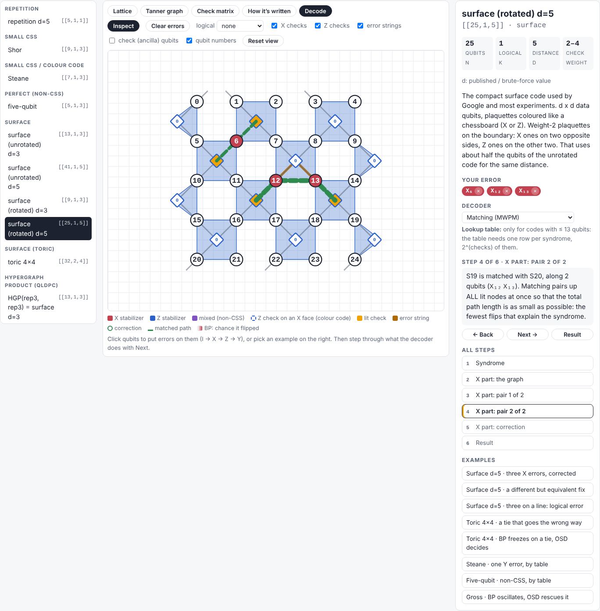

# qdec: quantum codes and decoders from scratch

> Any quantum error-correcting code can be written down as a check matrix and drawn as a picture.
> Start from that, build the decoders yourself, and watch every step they take.

`qdec` is a small, readable Python package plus a browser explorer. It builds 16 quantum codes from their geometry and their
check matrices, writes the noisy circuits for them, decodes with **our own** decoders (lookup, matching, belief propagation, BP + OSD),
and draws every step on the way. It is a tutorial and a review in code form.

-   :material-gesture-tap: **[Open the explorer](explorer/index.html){ target=_blank }**

    Click qubits to put errors on them, see the checks light up, and watch a decoder correct them step by step.
    Nothing to install.

-   :material-rocket-launch: **[Getting started](GETTING_STARTED.md)**

    Install the environment, run the 239 tests, the notebooks and the explorer, build this site.

-   :material-book-open-variant: **[Notebooks](notebooks/01_codes_tanner_bp.ipynb)**

    Seven notebooks that tell the story from codes to decoding, with a figure at every step.

-   :material-code-braces: **[Reading the code](CODE_GUIDE.md)**

    What each file is for, the order to read them in, and one decode traced through the files.

## The idea

1. **A code is a check matrix plus a picture.** Repetition, Shor, Steane, the five-qubit code, surface codes, toric, hypergraph products and
   the bivariate-bicycle family (including IBM's gross code) all become one Python object: stabilizers in symplectic form `(Sx | Sz)`
   plus a geometry. From that alone we compute n, k, d, the logical operators and the syndrome of any error.
2. **Look at it four ways:** lattice, Tanner graph, check matrix, and its written forms (stabilizer list, 0/1 matrices, polynomials).
3. **Make it noisy.** We write the syndrome-extraction circuits (with a CNOT order that avoids hook errors); Stim runs them and gives the
   detector error model: a graph (matching works) or a hypergraph (it doesn't).
4. **Decode it with decoders written here.** PyMatching and `ldpc` are used only as referees in the tests, and ours agree with them.
5. **See every step:** BP's beliefs round by round, matching's pairs one at a time, OSD's ranking, and whether the result was exact,
   a harmless degeneracy, or a logical error.

## The 16 codes

| family | codes |
|---|---|
| small codes | repetition [[5,1,1]] · Shor [[9,1,3]] · Steane [[7,1,3]] · five-qubit [[5,1,3]] (non-CSS) |
| surface codes | unrotated [[13,1,3]], [[41,1,5]] · rotated [[9,1,3]], [[25,1,5]] · toric [[32,2,4]] |
| hypergraph products | HGP(rep, rep) [[13,1,3]] · HGP(Hamming, Hamming) [[58,16,3]] |
| bivariate bicycle | [[72,12,6]] · [[90,8,10]] · [[108,8,10]] · **gross [[144,12,12]]** · [[288,12,18]] |

The theory of each family, with references, is in the [code catalogue](CODE_CATALOGUE.md).

## Results you can reproduce

* **Our MWPM = PyMatching** on every tested shot (rotated surface code, d = 3, 5, 7, circuit noise).
* **Our BP = ldpc's BP**; **our BP + OSD ≥ ldpc's** on the gross code (OSD ranks by BP's belief averaged over iterations).
* **Hook errors, measured:** circuit distance 3, 5, 7 with the Z/N CNOT order; 2, 3, 4 in the X basis with a plain order.
* **Graph vs hypergraph:** surface-code faults split into ≤ 2-detector pieces; gross-code faults light up to 9 detectors.
* **The explorer's decoders are the Python decoders:** identical on 1050/1050 random errors.

How each claim is checked: [Tests](TESTS.md). Design decisions and limits: [Architecture](ARCHITECTURE.md).
