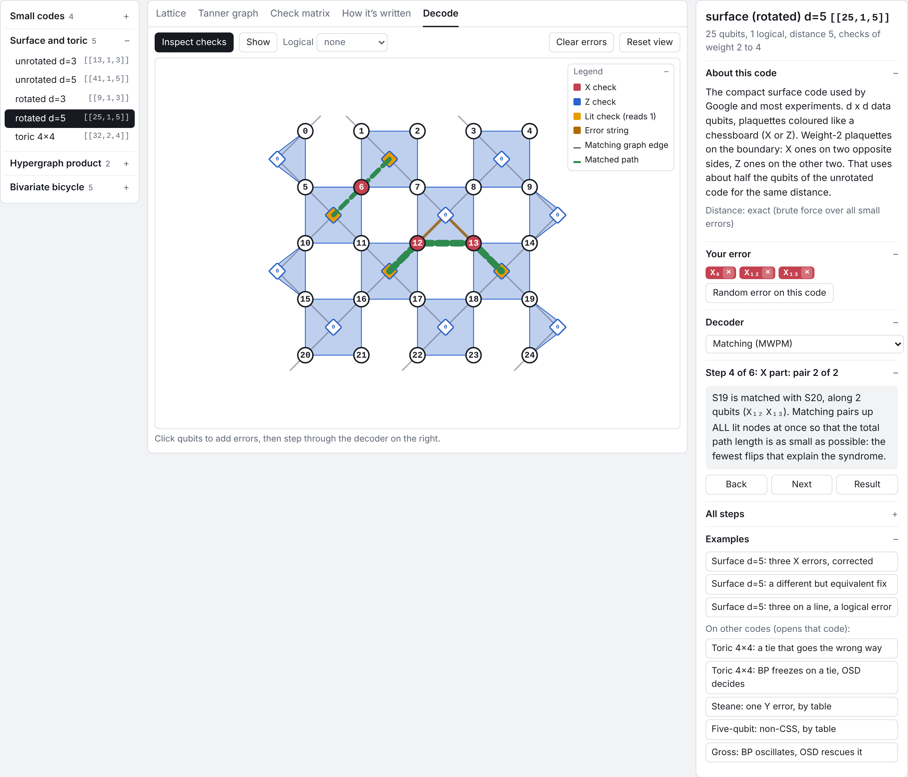

# QEC Decoder Exploration and Visualization

This project is my exploration of quantum error-correcting codes and their decoders. It started from one thought: any code can be
written down from its check matrix (for many families, just two polynomials), and that matrix is also the best starting point for
visualizing it. From there I build the codes, their circuits and my own decoders, and draw every step.

[Open the explorer](explorer/index.html){ .md-button .md-button--primary target=_blank }
[Getting started](GETTING_STARTED.md){ .md-button }

## What is here

- **16 codes** built from their check matrices, from the repetition code to the gross code $[[144,12,12]]$.
- **Four views of each code:** lattice, Tanner graph, check matrix, written form.
- **Decoders written from scratch:** lookup table, matching, belief propagation, BP + OSD.
- **An explorer:** click qubits to add errors and watch a decoder correct them.
- **Seven notebooks** from codes to circuits to decoding.

## Where to go

| you want to | read |
|---|---|
| try it in the browser | [the explorer](explorer/index.html) |
| install and run it | [Getting started](GETTING_STARTED.md) |
| follow the story | [the notebooks](notebooks/01_codes_tanner_bp.ipynb) |
| understand a code family | [Code catalogue](CODE_CATALOGUE.md) |
| read the source | [Reading the code](CODE_GUIDE.md) |
